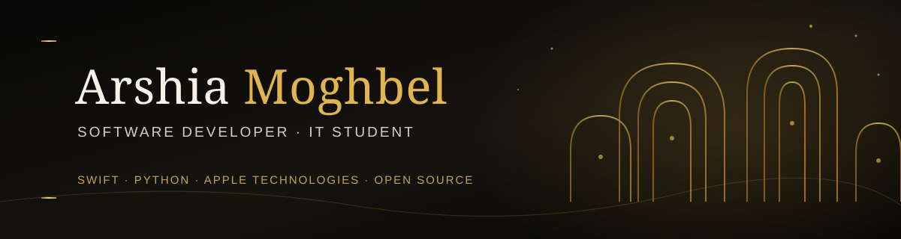

# 

  

  <a href="https://github.com/Arshia-Moghbel">GitHub</a>
  &nbsp;·&nbsp;
  <a href="https://linkedin.com/in/arshia-moghbel">LinkedIn</a>
  &nbsp;·&nbsp;
  <a href="mailto:arshiamoghbel@icloud.com">Email</a>

---

<h2 align="center">About Me</h2>

  I'm <strong>Arshia Moghbel</strong>, an IT student and software developer
  based in Isfahan, Iran.

  I'm interested in software engineering, Apple's development ecosystem,
  Python, and Artificial Intelligence.

  I enjoy building practical applications, exploring new technologies,
  solving engineering problems, and contributing to open-source projects.

---

<h2 align="center">Engineering Focus</h2>

<table>
  <tr>
    <td width="50%" align="center">
      <h3>🍎 Apple Development</h3>
      Swift · SwiftUI · Xcode · iOS · macOS
    </td>
    <td width="50%" align="center">
      <h3>🐍 Python Development</h3>
      Automation · APIs · Backend · Scripting
    </td>
  </tr>
  <tr>
    <td width="50%" align="center">
      <h3>🤖 Artificial Intelligence</h3>
      Machine Learning · Computer Vision · AI
    </td>
    <td width="50%" align="center">
      <h3>⚙️ Software Engineering</h3>
      Git · Architecture · Testing · CI/CD
    </td>
  </tr>
</table>

---

<h2 align="center">Featured Projects</h2>

<table>
  <tr>
    <td width="50%" valign="top">
      <h3>🤖 Telegram VPN Seller Bot</h3>
      

        A Python-based Telegram bot for VPN subscription management,
        featuring database integration and automated workflows.
      

      
<strong>Stack:</strong> Python · aiogram · SQLAlchemy · SQLite

      <a href="https://github.com/Arshia-Moghbel/Telegram-VPN-Seller-Bot">
        View Repository →
      </a>
    </td>
    <td width="50%" valign="top">
      <h3>📈 GoldLens</h3>
      

        A software project focused on tracking and analyzing
        gold and currency market data.
      

      
<strong>Focus:</strong> Financial Data · Software Development

    </td>
  </tr>
  <tr>
    <td width="50%" valign="top">
      <h3>🕰️ NixieTime</h3>
      

        A web-based clock inspired by vintage Nixie tube displays.
      

      
<strong>Focus:</strong> Web Development · JavaScript

    </td>
    <td width="50%" valign="top">
      <h3>🛠️ Developer Tools</h3>
      

        Experiments involving Git automation, network diagnostics,
        productivity tools, and software engineering.
      

      
<strong>Focus:</strong> Python · Automation · CLI

    </td>
  </tr>
</table>

  <a href="https://github.com/Arshia-Moghbel?tab=repositories">
    <strong>Explore All My Repositories →</strong>
  </a>

---

<h2 align="center">Open Source</h2>

  I believe open-source software is one of the best ways to learn,
  collaborate, and contribute to the developer community.

  <strong>XERJ Corpus Hub Contributor</strong>

  My contributor profile is featured in the XERJ Corpus Hub.

  <a href="https://hub.xerj.org/contributors/Arshia-Moghbel">
    View Contributor Profile →
  </a>

---

<h2 align="center">Technologies & Tools</h2>

<h3 align="center">Programming Languages</h3>

  Python · Swift · C++ · HTML · CSS · JavaScript

<h3 align="center">Apple Ecosystem</h3>

  Swift · SwiftUI · Xcode · iOS · macOS

<h3 align="center">Developer Tools</h3>

  Git · GitHub · GitHub Actions · Docker · VS Code

<h3 align="center">Other Technologies</h3>

  WordPress · Linux · Automation

---

<h2 align="center">Currently Exploring</h2>

<table>
  <tr>
    <td>📱 Swift & Apple Development</td>
    <td>🤖 Machine Learning</td>
  </tr>
  <tr>
    <td>👁️ Computer Vision</td>
    <td>🧠 Deep Learning</td>
  </tr>
  <tr>
    <td>🏗️ Software Architecture</td>
    <td>🔄 CI/CD & Automation</td>
  </tr>
  <tr>
    <td>🌐 Open Source Development</td>
    <td>🔐 Software Security</td>
  </tr>
</table>

---

<h2 align="center">Development Principles</h2>

  Clean Code &nbsp;·&nbsp;
  Maintainability &nbsp;·&nbsp;
  Security &nbsp;·&nbsp;
  Documentation &nbsp;·&nbsp;
  Continuous Learning

---

<h2 align="center">Connect With Me</h2>

  <a href="https://github.com/Arshia-Moghbel">
    GitHub
  </a>
  &nbsp;·&nbsp;
  <a href="https://linkedin.com/in/arshia-moghbel">
    LinkedIn
  </a>
  &nbsp;·&nbsp;
  <a href="https://instagram.com/arshia__m__2008">
    Instagram
  </a>
  &nbsp;·&nbsp;
  <a href="mailto:arshiamoghbel@icloud.com">
    Email
  </a>

---

  <strong>BUILDING · LEARNING · CONTRIBUTING</strong>

  Thanks for visiting my GitHub profile.

